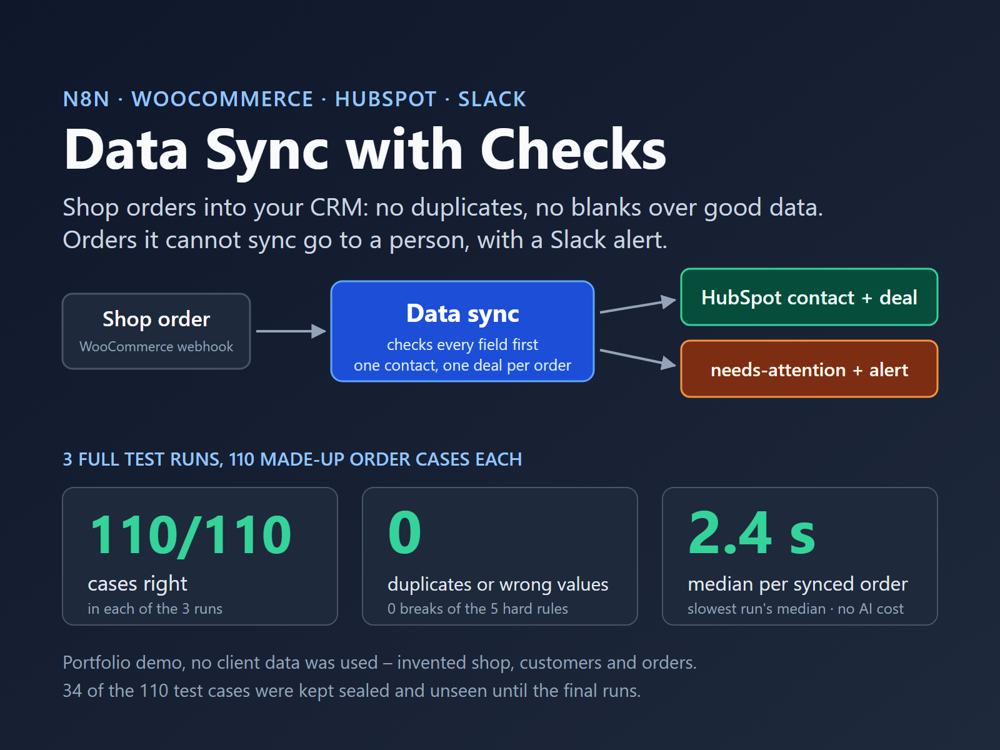
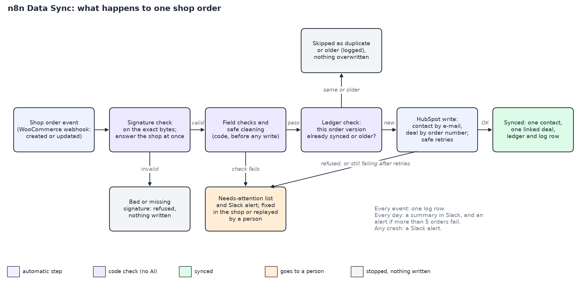

# n8n Data Sync

An n8n workflow that copies shop orders from WooCommerce into HubSpot. It checks every field before it writes anything, never creates a duplicate contact or deal, never replaces good data with a blank or an older update, and sends the orders it cannot sync to a person with a Slack alert (the exceptions are listed under Limits).

## Problem

A small online shop sells through WooCommerce and keeps its customers in a CRM. Orders are copied by hand, or by an automation that breaks quietly: the same customer appears twice, an order arrives without its total or e-mail, an update overwrites good data, and when a sync fails nobody knows until a report or a customer is wrong.

## Solution

For every order event the shop sends (new order or update), the workflow:

1. **Checks the sender.** WooCommerce signs every webhook. The workflow checks the signature on the exact bytes it received; a request without a valid signature is refused and nothing is written. Every signed request gets an answer at once, so WooCommerce does not switch the webhook off after failed deliveries.
2. **Checks every field before any write.** Order number, e-mail, a name, total, currency, status and dates must be there and valid (for example, a total like "12,50" or a negative total is not accepted). An order that fails a check is not written; it goes to the needs-attention list with the reason.
3. **Cleans only what is safe.** It trims spaces, writes e-mails in lower case and joins double spaces in names. It never guesses: no phone country is added, no name is re-cased, no total is "fixed".
4. **Never creates a duplicate.** One contact per e-mail address (also when the shop sends it in another case or with spaces) and one deal per order number. An order sent twice, or twice at the same moment, still gives one deal. Every write to HubSpot is an update-or-create by that key, so a retry cannot create a copy.
5. **Never overwrites good data with worse data.** An empty field in an update keeps the value HubSpot already has. An older version of an order that arrives after a newer one is skipped.
6. **Retries HubSpot safely.** When HubSpot is busy (429), has a server error or does not answer in time, the call is tried again. If it still fails, or HubSpot refuses the data, the order goes to the needs-attention list.
7. **Sends every failed order to a person.** Each one gets one row in the needs-attention list and one Slack alert in `#data-sync-alerts`. When the shop sends a corrected version, the order syncs and the row closes by itself. After a HubSpot outage, a person presses replay in a small password-protected form, and the order syncs once.
8. **Reports every day.** One Slack message a day: orders synced, updated, skipped, sent to needs-attention, still open. An extra alert when more than 5 orders fail in one day, and an alert for any crash.

There is no AI step: every check is a fixed rule, so code is cheaper, faster and fully testable. AI is used only where it helps, and here it does not.

## System

| Part | Used here |
|---|---|
| Automation | n8n 2.43.7, self-hosted (local) |
| Shop | WooCommerce order webhooks (`order.created`, `order.updated`); in the demo a test runner sends real-format, signed WooCommerce events |
| CRM | HubSpot (free account, service key); contact by e-mail, deal by a unique order-number property, deal linked to the contact |
| Alerts and summary | Slack, channel `#data-sync-alerts` |
| Memory of the sync | n8n data tables: ledger (which order version is synced; it keeps a fingerprint of the data, not the data), needs-attention list, log, alerts |

Workflows in [`workflows/live/`](workflows/live/) (generated by [`workflows/build.py`](workflows/build.py), no credentials):

| File | Purpose |
|---|---|
| `entry.json` | Receives the WooCommerce webhook, checks the signature, answers at once |
| `core.json` | Field checks, cleaning, ledger check, needs-attention rows and alerts |
| `hubspot-call.json` | HubSpot writes with the safe retries |
| `replay.json` | Password-protected form to replay a needs-attention row |
| `summary.json` | Daily summary and the over-5-failures alert |
| `error.json` | Slack alert on any crash |

Design decisions are recorded in [`adr/`](adr/): amounts in the shop's currency field, the deal close date, and how the webhook reads the exact bytes for the signature check.

## Outcome

Tested on **110 made-up WooCommerce order cases**, run **3 times** on one frozen version of the workflows (2026-10-26). The expected result of every case was written down before the runs. 76 cases are visible in this repository (67 written before the build, 9 added after the first test series); 34 were written and sealed by a separate AI writer that never saw the build, and opened only for these runs. All numbers below come from that record ([`evals/RESULTS.md`](evals/RESULTS.md), second test series; result files in [`tests/results/`](tests/results/)).

| Result | Number |
|---|---|
| Cases with the expected result | **110 of 110 in each of the 3 runs** |
| Breaks of the 5 hard rules (right values, no duplicates, nothing bad written, nothing lost or silent, good data kept) | **0** |
| Secrets found in logs, alerts or results | 0 |
| Cases that changed result between runs | 0 |
| Time from webhook to synced order | median 2.4 s, slowest 24.6 s (worst run; all synced orders, including orders that waited for retries after simulated HubSpot errors) |
| Real HubSpot errors | 1 per run: two events for one new customer at the same moment; HubSpot refused one contact write; one retry fixed it each time |
| Cost per order in the test | $0 (no AI step; HubSpot and Slack free plans; n8n hosting not counted) |

What the cases cover: clean orders; messy but valid orders (spaces, upper-case e-mails, accents and non-Latin names, phone formats); returning customers; updates, refunds and late older updates; resent and parallel orders; each missing field; invalid formats; bad, missing and changed signatures; HubSpot errors (simulated: 429, server errors, timeouts, closed connections, 400/401/403/404); replay and fixes from the shop; the daily summary; and a forced crash in an automatic run, which must alert in Slack.

**A failure on the way.** The first test series on 2026-10-26 failed: 95 of 96 cases in each run. One sealed case had two open needs-attention rows for the same order, and the second row never closed, because a setting made one n8n step read only its first input row. The fix removed that setting from 9 steps, an automatic check ([`tests/check_execute_once.py`](tests/check_execute_once.py)) now runs before every test series, and 9 new cases were added. The new series above was run with a new set of sealed cases from the same kind of separate writer. Both series are in [`evals/RESULTS.md`](evals/RESULTS.md).

How the test works: [`tests/runner.py`](tests/runner.py) signs and sends each event, then reads HubSpot and the n8n tables back and grades the case in code; [`tests/score.py`](tests/score.py) checks the 3 runs together. HubSpot errors come from a local fault proxy ([`tests/proxy.py`](tests/proxy.py)) and are labelled "simulated". The demo shop, Harbour E-Bikes, is made up; every name, e-mail (`example.com` domains), address and order is invented.

### Limits

- Tested on made-up orders in a local n8n. Not measured: real shops, high volume, and webhooks that never arrive (that needs a nightly comparison with the shop, a version 2 idea).
- The keyless checks run in CI on Linux, macOS and Windows; the full test series, which needs n8n, HubSpot and Slack, ran only on Windows 11.
- The tests ran on the test copy of the workflows: HubSpot calls go through the fault proxy, a forced-crash switch is on, and the daily summary is started by the test runner. The live export in `workflows/live/` is generated by the same code without these test-only parts, but has not been run yet, and its 08:00 schedule was not run in the tests.
- If two updates of one order arrive within about 2 seconds, the older one can show in HubSpot until the next update arrives.
- If two events for the same new customer arrive at the same moment, HubSpot can refuse one contact write. The workflow retries once after 1 second; if HubSpot refuses again, the order goes to needs-attention with an alert, and replay or the next shop update fixes it.
- The demo's free HubSpot account has one currency, so the order's currency is stored in the deal field `shop_currency`; the amount shows in the account's currency format.
- Rejected requests (bad signature, body over 256 KB) are logged, not alerted.
- Allowed currencies are EUR, GBP and USD; an order in any other currency goes to needs-attention until the list is changed (see Going live).
- The check that two parallel writes for one new order give one ledger row was proven on n8n's default SQLite database only. If the host uses Postgres, re-run that check (N-LEDGER in [`tools/probe.py`](tools/probe.py)) there.
- Order numbers that differ only in upper and lower case (`HB-1` and `hb-1`) are treated as two orders.
- If the workflow crashes after the HubSpot writes, the crash alert goes to Slack but no needs-attention row is made. If Slack itself fails, nothing else alerts. If n8n restarts while an order is being synced, that order can be lost without an alert.
- Needs-attention and log rows are kept until someone removes them; set a retention rule before go-live.
- If the HubSpot amounts feed invoicing or accounting, use a stricter test and review setup for that client.

### Going live

The live export carries placeholders instead of credential and workflow IDs, so going live is an install step, done once with the client:

1. **Host.** Use n8n Cloud or a managed n8n host with HTTPS (the demo n8n is local and not reachable from the internet).
2. **HubSpot.** Create a service key on the client's HubSpot with contact and deal read/write. Create the deal properties `shop_order_id` (unique), `shop_modified_at` (date-time) and `shop_currency`, and the contact property `sync_source`. On a paid HubSpot with several currencies set up, HubSpot's own `deal_currency_code` is the better field for the currency ([ADR-001](adr/001-currency-in-shop-currency.md)).
3. **Slack.** A Slack app with `chat:write`, invited to `#data-sync-alerts`.
4. **Webhook secret.** Generate one long random secret. Put it in the n8n Crypto credential `Crypto WooCommerce n8n-data-sync` and in **both** WooCommerce webhooks (`order.created` and `order.updated`), delivery URL `https://<your-n8n>/webhook/q129-order`.
5. **Replay login.** A Basic Auth credential for the replay form.
6. **Shop settings.** In [`workflows/sync_js.py`](workflows/sync_js.py) set the allowed currencies (`CURRENCIES`), the shop-status-to-deal-stage map (`STAGE`, `STAGE_IDS`), the deal pipeline (`pipeline: 'default'`) and the `sync_source` value, then run `python workflows/build.py` to rebuild the files in `workflows/live/`.
7. **Data tables.** Create the 4 tables `q129_ledger`, `q129_attention`, `q129_log` and `q129_alerts`, with the columns listed in `TABLES` in [`workflows/build.py`](workflows/build.py).
8. **Import.** Import the files in `workflows/live/` in this order: `error`, `hubspot-call`, `core`, `entry`, `replay`, `summary`. In each workflow select the credentials and the sub-workflows it calls; in Entry, Replay and Summary select `Q129 Error` as the error workflow. Then publish.
9. **Settings.** Set n8n's time zone to the client's (the summary runs at 08:00 n8n time). An alert for "no order in X hours" is not built; add it at go-live if the shop wants it. After any n8n upgrade, run `python tools/probe.py --only n8n` again: the order webhook depends on version 1 of n8n's Webhook node ([ADR-003](adr/003-order-webhook-v1-binary-body.md)).
10. **Check before real data.** Before importing the live export, run the test copy and the test set on the client's host with a test HubSpot account. Then send one test order from the shop. Force one failure in an automatic run (for example, a temporary Stop and Error node at the start of Core, then one test order) and see the crash alert arrive in `#data-sync-alerts`; remove the node. After any change of the secret, send one test order again.
11. **Rollback.** Deactivate the workflows, import the previous version from git, and replay the needs-attention rows.

## Version Log

| version | date | change |
|---|---|---|
| 0.0 | 2026-10-20 | Scaffold and plan |
| 0.1 | 2026-10-20 | First build in local n8n; development test runs |
| 0.2 | 2026-10-26 | First official test series: FAIL (95 of 96 cases in each run) |
| 0.3 | 2026-10-26 | Fix and 9 new cases; second official test series: PASS (110 of 110 in each run) |
| 0.4 | 2026-10-28 | README for clients, diagram and cover image |
| 0.5 | 2026-10-30 | Public release; keyless checks run in CI on Linux, macOS and Windows |
